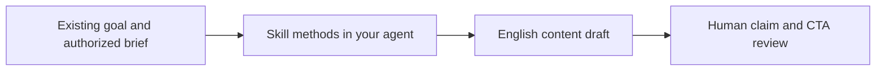

# Global Positioning & Growth Content

**English product content from your existing brief, inside your agent.**

A Markdown Skill for independent developers and small product teams who already have a target reader and product facts. Bring your goal, workflow and evidence; ask your Skill-compatible agent for positioning, a homepage hero, a README or another content draft. Review the claims before publishing.

[Get the source](https://github.com/NextVariable/global-growth-content-skill) · [MIT license](https://github.com/NextVariable/global-growth-content-skill/blob/main/skills/global-growth-content/LICENSE)



## Quick start

You need Git to obtain the repository, a Skill-compatible client, its model access, and the client’s configured Skill directory. The Skill itself does not require a pip/npm package, mandatory business script, online service or paid API. Your host client controls its own tools and costs.

Run the following in a POSIX-compatible shell from a workspace where global-growth-content-skill does not already exist. When prompted, enter the Skill root configured for your client. This copies the complete installation unit and refuses to overwrite an existing global-growth-content directory.

```sh
git clone https://github.com/NextVariable/global-growth-content-skill.git
cd global-growth-content-skill
printf 'Configured client Skill root: '; IFS= read -r SKILL_ROOT
if [ -z "$SKILL_ROOT" ]; then
  printf 'No Skill root entered; nothing copied.\n'
elif [ -e "$SKILL_ROOT/global-growth-content" ]; then
  printf 'Existing Skill found; inspect and preserve it before updating.\n'
else
  mkdir -p "$SKILL_ROOT" && cp -R skills/global-growth-content "$SKILL_ROOT/"
fi
```

The source directory skills/global-growth-content is the installation unit, not the entire repository. Keep all its files together. Successful copying should leave SKILL.md, six references, one handoff template, agents/openai.yaml and LICENSE in the destination. If the copy fails, correct the directory or permission problem and inspect the destination before retrying; do not treat a partial copy as installed.

Next, follow your client’s discovery or refresh instructions and confirm that it lists global-growth-content. A file copy alone does not confirm client discovery. Then start one task:

```text
Use $global-growth-content to rewrite our English homepage hero.
Keep the reader and product facts below. Return a complete headline,
subheading, real CTA and prerequisites. Separately map claims to facts;
flag unsupported assumptions. Do not publish or create a full content pack.

Product: Global Positioning & Growth Content, a Markdown methods Skill.
Reader: independent developers and small product teams who already know
their target readers and need English product content in a compatible agent.
Goal: explain this Skill and help a new reader try one drafting task.
Workflow: product brief and evidence -> task-specific methods -> agent draft
-> human factual review.
Supported facts: independent 10-file installation unit;
no mandatory business script or paid API;
host client supplies model access;
MIT licensed; drafts positioning, pages, README and other content assets;
does not perform publishing, outreach, ad buying, sales or experiments.
Evidence limit: isolated copying and source/link checks were completed
on 2026-10-10; all-client discovery and writing outcomes were not verified.
No customer, speed, conversion, model-quality or pricing data is supplied.
Next-step destinations:
https://github.com/NextVariable/global-growth-content-skill
https://github.com/NextVariable/global-growth-content-skill/blob/main/README.md
```

Expected result: one complete English hero and a separate claim map. Check that it identifies the Skill, addresses the fixed reader, explains the input-to-draft mechanism, preserves model/client prerequisites and links to the real repository. Remove any invented results. Your agent’s text will vary; no fixed model response or performance outcome is promised.

## What you can use it for

Start from the task you actually need: express an existing positioning judgment, explain a product workflow on a page, help a developer reach a first task through a README, or prepare search content and platform-specific social/UGC briefs. Language adaptations are available when requested. A one-off task can stay a one-off task.

The reusable methods keep content work connected to supplied product facts and evidence. A direct prompt remains a reasonable option for a simple rewrite; no customer study establishes that this Skill is better than your own prompt documents.

## Scope and project materials

This Skill handles expression and content assets. Existing market/customer choices come from your inputs; first-stage handoffs can be plain text and do not require a separate installation. Actual publishing, outreach, advertising, sales and experiments sit outside this task’s scope. Draft generation does not validate market demand or business results.

Keep customer briefs and ongoing project records outside the installed Skill directory. Provide only materials you are authorized to use, plus the target reader, workflow, evidence and current objective. When outcome evidence is missing, ask for capability-based copy and explicitly exclude unsupported results.

## Installation troubleshooting

If the clone directory already exists, inspect that checkout rather than cloning over it. If the Skill destination already exists, preserve it and compare versions before updating. If your client does not find the Skill, verify the configured root, directory name, SKILL.md and supporting files, then use that client’s documented discovery process. Avoid assuming every client uses the same installation path.

If references cannot be opened, check that you copied the whole installation unit. If model access fails, fix access in the host client; there is no Skill-specific model service. If output changes your audience or invents claims, repeat the fixed brief and request a revision tied to its evidence. A draft from a client that did not load the Skill is not evidence that the Skill ran.

## Verification and versions

On 2026-10-10, the complete 10-file package was copied to an isolated temporary Skill directory; its entry and internal links passed source checks. This verifies that isolated copy, not universal discovery, generated content quality or commercial effectiveness.

Repository contents may differ from local working versions. Inspect the downloaded files when deciding what you are using; this README draft does not establish that an unpublished local method revision is already on GitHub.

## License

MIT. See the [installation unit’s LICENSE](https://github.com/NextVariable/global-growth-content-skill/blob/main/skills/global-growth-content/LICENSE).

If the source looks useful, [star the repository](https://github.com/NextVariable/global-growth-content-skill) to bookmark it. The first adoption step is still installing the complete unit and completing one reviewed task.

---

# Internal publication note — remove from a published README

Reader: fixed developer/small-team audience with an existing brief. Purpose: acquire the unit, confirm client discovery and reach one reviewed hero. Evidence: P1–P3/P5/P6 for capability and setup; P4 for dated isolated-copy scope; P7 for license and real repository. This is a replacement candidate, not an edit to the live README. No network installation was run during this writing task. Copy semantics follow the permitted supplied installation record; the interactive example adds a non-overwrite guard but has not been tested against a real client. No logo, GIF, CI badge, community channel, package installer, endpoint or observed model output has been invented. Latest local methods differ from remote; publication needs a version check.
